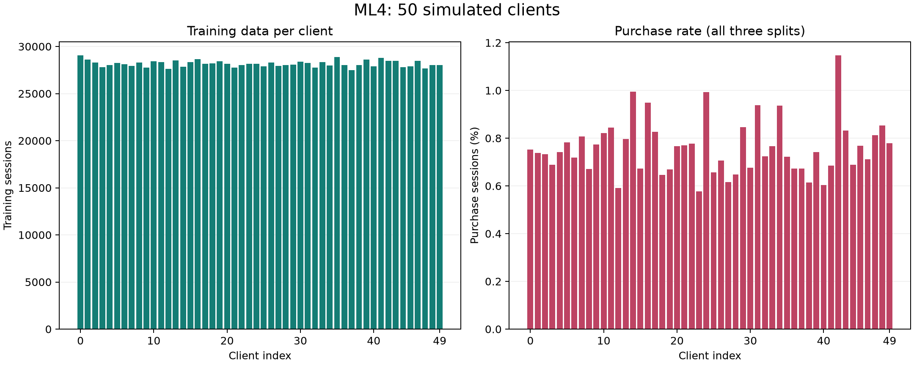
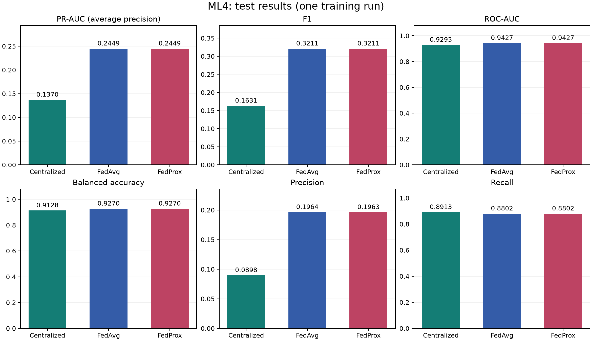
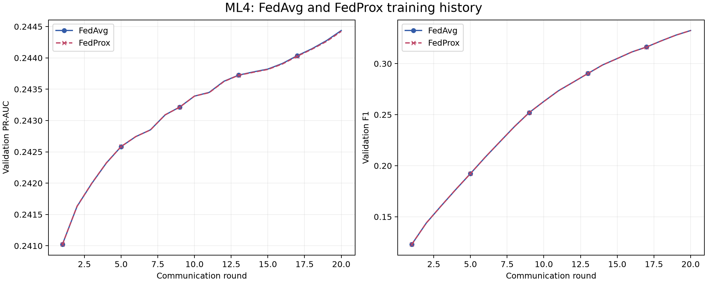

# ML4 Federated Learning Results

## 4.3.5.1. Thiết lập client

Dữ liệu ML4 được xây dựng ở mức session từ tập `user_item_event_final.csv`. Mỗi dòng biểu diễn một phiên truy cập và nhãn `label_has_purchase` cho biết session có phát sinh mua hàng hay không. Để mô phỏng Federated Learning, mỗi `visitorid` được ánh xạ cố định vào một `client_id`, nhờ đó toàn bộ session của cùng một khách hàng luôn thuộc cùng một client.

Thiết lập trong lần chạy này:

- Số client: 50
- Số session train: 1,408,588
- Số session validation: 176,074
- Số session test: 176,074
- Số session nhỏ nhất trên một client (tổng ba split): 34,612
- Số session lớn nhất trên một client (tổng ba split): 36,183
- Tỷ lệ purchase trung bình theo client (tổng ba split): 0.0076

## 4.3.5.2. Centralized Training

Centralized Training dùng toàn bộ tập train để huấn luyện một mô hình Logistic Regression. Đây là baseline tập trung, dùng để so sánh với FedAvg và FedProx. Mô hình chỉ sử dụng các đặc trưng quan sát được trước nhãn mua hàng như số sự kiện quan sát được, số lượt xem, số lượt thêm giỏ hàng, số sản phẩm khác nhau, thời lượng quan sát và tỷ lệ view-to-cart.

Mô hình được huấn luyện trên 1,408,588 phiên bằng
`SGDClassifier(loss="log_loss")`, với class weight `balanced`, regularization L2
(α = 0.00001), `max_iter = 20`, `tol = 0.0001` và `random_state = 42`.
`StandardScaler` được fit trên train rồi dùng chung cho validation/test.
Ngưỡng phân loại trong lần chạy này là 0.5.

Kết quả của baseline trên hai tập đánh giá:

| Chỉ số | Validation | Test |
| --- | ---: | ---: |
| ROC-AUC | 0.9332 | 0.9293 |
| PR-AUC (average precision) | 0.1361 | 0.1370 |
| Balanced Accuracy | 0.9133 | 0.9128 |
| Precision | 0.0946 | 0.0898 |
| Recall | 0.8944 | 0.8913 |
| F1 | 0.1711 | 0.1631 |
| Accuracy | 0.9319 | 0.9341 |

Trên test, ROC-AUC đạt 0.9293 và PR-AUC đạt
0.1370. Recall = 0.8913 cho biết
mô hình nhận diện khoảng 89.13% phiên mua hàng,
trong khi Precision = 0.0898 cho biết chỉ khoảng
8.98% phiên được dự đoán mua thực sự có mua.
Baseline phát hiện nhiều phiên positive nhưng còn nhiều dự đoán dương tính giả,
thể hiện qua F1 = 0.1631.

Mô hình gán nhãn mua cho 7.15% phiên
test, trong khi tỷ lệ mua thực tế chỉ 0.72%.
Accuracy = 0.9341 vì vậy cần đọc cùng Balanced Accuracy
= 0.9128, PR-AUC và F1. ROC-AUC validation =
0.9332 so với test = 0.9293;
PR-AUC validation = 0.1361 so với test =
0.1370. Các chỉ số này khá gần nhau trong lần chạy đã lưu.

## 4.3.5.3. FedAvg

FedAvg được mô phỏng bằng cách huấn luyện mô hình cục bộ trên từng client, sau đó server tổng hợp tham số theo trung bình có trọng số dựa trên số mẫu của mỗi client. Số vòng huấn luyện là 20, learning rate là 0.05, và mỗi client chạy 3 local epoch trong một vòng.

Tất cả 50 client tham gia mỗi round. Trong script, mỗi local
epoch là một bước gradient dùng toàn bộ dữ liệu cục bộ. Mô hình dùng cùng bảy đặc
trưng/scaler với baseline, với trọng số purchase 130.5700
so với trọng số 1 của lớp không mua.

Kết quả của FedAvg sau round cuối:

| Chỉ số | Validation | Test |
| --- | ---: | ---: |
| ROC-AUC | 0.9475 | 0.9427 |
| PR-AUC (average precision) | 0.2444 | 0.2449 |
| Balanced Accuracy | 0.9306 | 0.9270 |
| Precision | 0.2045 | 0.1964 |
| Recall | 0.8886 | 0.8802 |
| F1 | 0.3324 | 0.3211 |
| Accuracy | 0.9720 | 0.9732 |

Lịch sử validation cho thấy từ round 1 đến round 20, PR-AUC thay đổi từ 0.2410 sang 0.2444, F1 từ 0.1229 sang 0.3324 và Precision từ 0.0659 sang 0.2045. Recall thay đổi từ 0.9111 sang 0.8886. Các giá trị này được lấy từ `ml4_training_history.csv`, không phải lịch sử test.

Trên test, FedAvg đạt PR-AUC = 0.2449, F1 =
0.3211 và Precision = 0.1964. Hiệu số
**FedAvg − Centralized** là +0.1078
cho PR-AUC và +0.1580 cho F1 trên thang 0 đến 1.
Precision chuyển từ 0.0898 ở centralized sang
0.1964 ở FedAvg, còn Recall từ 0.8913
sang 0.8802. Kết quả thể hiện sự đánh đổi giữa độ chính xác của
các dự đoán mua và khả năng bao phủ các phiên có mua hàng.

Phương án huấn luyện theo client đạt chất lượng dự đoán tốt trong mô phỏng này.
Tuy nhiên, centralized và FedAvg dùng lịch tối ưu khác nhau; chênh lệch quan sát
được chưa tách riêng ảnh hưởng của thuật toán FL khỏi cấu hình tối ưu.

## 4.3.5.4. FedProx

FedProx sử dụng cùng thiết lập với FedAvg nhưng bổ sung proximal term để hạn chế mô hình cục bộ lệch quá xa mô hình global. Hệ số proximal trong lần chạy này là `0.1`.

Thiết lập giữ nguyên 50 client, 20 round,
3 local epoch và learning rate 0.05 như FedAvg.
Trong bản ML4 này, proximal term được áp dụng cho vector weight, không áp dụng
cho bias. Mọi client đều tham gia và server tổng hợp theo số phiên train.

Kết quả của FedProx sau round cuối:

| Chỉ số | Validation | Test |
| --- | ---: | ---: |
| ROC-AUC | 0.9475 | 0.9427 |
| PR-AUC (average precision) | 0.2444 | 0.2449 |
| Balanced Accuracy | 0.9306 | 0.9270 |
| Precision | 0.2045 | 0.1963 |
| Recall | 0.8886 | 0.8802 |
| F1 | 0.3324 | 0.3211 |
| Accuracy | 0.9720 | 0.9732 |

Lịch sử validation cho thấy từ round 1 đến round 20, PR-AUC thay đổi từ 0.2410 sang 0.2444, F1 từ 0.1230 sang 0.3324 và Precision từ 0.0659 sang 0.2045. Recall thay đổi từ 0.9111 sang 0.8886. Các giá trị này được lấy từ `ml4_training_history.csv`, không phải lịch sử test.

Trên test, FedProx đạt ROC-AUC = 0.9427, PR-AUC =
0.2449, F1 = 0.3211 và Recall =
0.8802. Các giá trị này rất gần FedAvg. Để tránh việc làm tròn
bốn chữ số che mất chênh lệch, hiệu số **FedProx − FedAvg** trên test được ghi thêm
ở độ chính xác sáu chữ số: PR-AUC = -0.000014,
F1 = -0.000046 và ROC-AUC =
-0.000001.

Với μ = 0.1 và cách chia client hiện tại, chưa quan sát được lợi
thế chất lượng dự đoán rõ của FedProx so với FedAvg. Các chênh lệch rất nhỏ trong
một lần chạy chưa đủ để kết luận phương pháp nào vượt trội về thống kê. Mức độ
không đồng nhất giữa client và lựa chọn μ có thể ảnh hưởng kết quả, nhưng lần thử
này chưa quét nhiều μ hay thay đổi mức non-IID để xác định nguyên nhân.

## 4.3.5.5. So sánh kết quả

| Model | ROC-AUC | PR-AUC | Balanced Accuracy | Precision | Recall | F1 |
| --- | ---: | ---: | ---: | ---: | ---: | ---: |
| Centralized Logistic Regression | 0.9293 | 0.1370 | 0.9128 | 0.0898 | 0.8913 | 0.1631 |
| FedAvg | 0.9427 | 0.2449 | 0.9270 | 0.1964 | 0.8802 | 0.3211 |
| FedProx | 0.9427 | 0.2449 | 0.9270 | 0.1963 | 0.8802 | 0.3211 |

Ghi chú: vì tỷ lệ session mua hàng rất thấp, Accuracy tổng thể dễ gây hiểu nhầm. Do đó phần so sánh ưu tiên ROC-AUC, PR-AUC, Recall, F1 và Balanced Accuracy.

Bảng và biểu đồ lấy từ một lần chạy ML4 đã lưu, không phải trung bình nhiều seed.
Đường huấn luyện dùng validation qua từng round; FedAvg và FedProx gần trùng nhau
nên dùng nét liền và nét đứt để phân biệt. Hiện không có log theo epoch của mô hình
centralized, vì vậy không vẽ đường huấn luyện giả cho baseline này.
Centralized và FL có lịch tối ưu khác nhau trong script hiện tại, nên kết quả phản
ánh các cấu hình đã chạy và chưa chứng minh FL nói chung tốt hơn huấn luyện tập trung.

## 4.3.5.6. Trả lời RQ4

Kết quả cho thấy Federated Learning có thể huấn luyện mô hình dự đoán mua hàng mà không cần gom toàn bộ dữ liệu raw event về một nơi trong quá trình mô phỏng client. FedAvg và FedProx sử dụng cùng dữ liệu đã chia theo client, chỉ tổng hợp tham số mô hình ở phía server. So với Centralized Training, hiệu quả của FL phụ thuộc vào mức độ không đồng nhất giữa client, số vòng truyền thông, learning rate và số mẫu trên từng client.

Trong thiết lập này, FedAvg và FedProx cho kết quả gần như tương đương. Chưa quan
sát được lợi thế rõ của FedProx với bộ đặc trưng session, μ và cách chia client hiện
tại. Lần chạy này chưa quét μ hoặc thay đổi mức non-IID, nên chưa thể xác định
nguyên nhân của sự tương đồng. Cả hai phương pháp FL đạt kết quả cạnh tranh với
baseline tập trung trên ROC-AUC, PR-AUC, Balanced Accuracy và F1; việc diễn giải
chênh lệch vẫn cần xét đến lịch tối ưu khác nhau của các mô hình.

Kết luận cho RQ4: Federated Learning là khả thi trong bối cảnh dữ liệu thương mại điện tử đã chia theo khách hàng, vì mô hình vẫn có thể được huấn luyện thông qua tổng hợp tham số mà không cần tập trung raw data của từng client. Tuy nhiên, chất lượng mô hình phụ thuộc vào cách chia client, mức độ non-IID, số vòng huấn luyện, learning rate và số local epoch.
